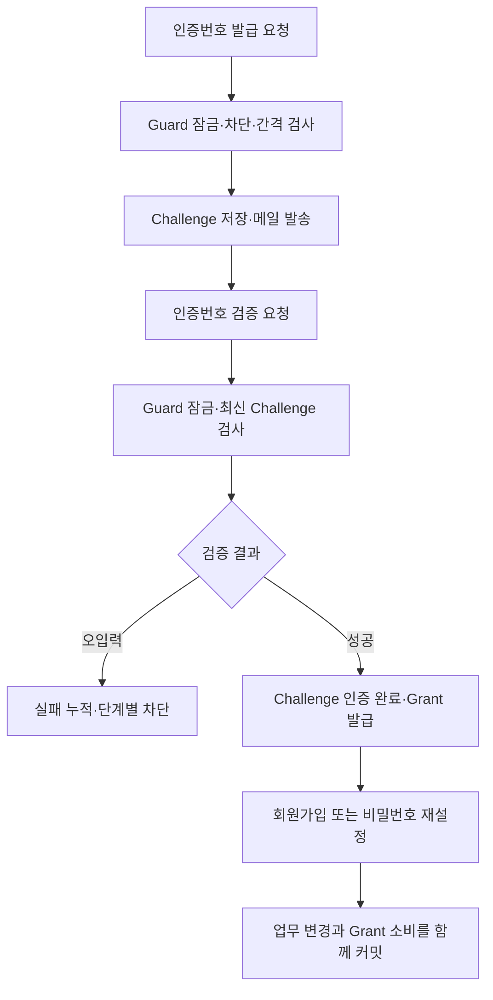

# SlotKey V1 인증 구현 해설

> 기준: 2026-10-15 / PR #302 / `5c60fa444dfc427016954fdacc44d3dfd293c004`  
> 이 문서는 V1의 구현 스냅샷이다. V2·V3 구현 완료를 설명하지 않는다.  
> 관련 문서: [정책](../decisions/authentication-policy.md), [테스트](../testing/auth-security-tests.md)  
> V1 기준점으로 보존하는 문서다. V2 구현 내용은 이 문서를 덮어쓰지 않고 별도 문서로 작성한다. 기준점 이후 변경(2026-10-18 확인): PR #302 병합 `46526a5`, Gmail SMTP 전환 #318.

## 1. 전체 구조

V1은 이메일 소유 확인과 가입·복구 작업을 분리한다. 이메일로 받은 번호를 검증하면 짧은 수명의 grant를 발급하고, 가입 또는 재설정은 그 grant를 소비한다.

로그인 이후의 AT 검증은 기존 JWT 중심 구조를 유지한다. 따라서 이메일 인증 기능의 완성과 로그인 세션 즉시 폐기는 별도 문제다.

## 2. 클래스 읽기 지도

주요 패키지의 기준 경로는 `backend/src/main/java/com/ovengers/slotkey/`다.

| 클래스 | 책임 | 읽을 때 확인할 질문 |
| --- | --- | --- |
| auth/controller/VerificationController | 발급·검증 HTTP 입출력 | 실패 상태를 언제 HTTP 예외로 바꾸는가? |
| auth/service/VerificationChallengeService | 번호 발급·재발송·메일 | 잠금 중 어떤 외부 호출을 하는가? |
| auth/service/VerificationCheckService | 번호 검증·실패 누적·grant 발급 | 차단과 회원 정지를 어떻게 구분하는가? |
| auth/service/VerificationGuardService | Guard 생성 및 잠금 | 동시에 첫 요청이 들어오면 어떻게 되는가? |
| auth/service/VerificationGrantService | grant의 귀속·수명·소비 여부 검사 | 왜 외부 트랜잭션이 필요한가? |
| member/service/MemberService | 이메일 인증 기반 회원가입 | grant 소비와 크레딧 처리 순서는? |
| auth/service/PasswordResetService | 비밀번호 변경과 grant 소비 | 기존 토큰은 함께 폐기되는가? |
| auth/service/AuthService | 로그인·AT 재발급 | 회원 상태를 언제 확인하는가? |
| auth/service/RefreshTokenService | RT 발급·해시 조회·폐기 | 갱신 때 RT가 교체되는가? |
| global/security/CustomAuthenticationFilter | JWT 검증·인증 객체 구성 | DB의 현재 상태를 조회하는가? |

## 3. 데이터 책임 분리

### 3.1 Member와 LocalCredential

Member는 프로필·역할·상태를, LocalCredential은 비밀번호 해시·변경 시각을 담당한다. 로컬 비밀번호가 없는 로그인 수단을 나중에 추가하더라도 Member에 가짜 비밀번호를 채워 넣지 않도록 책임을 나눈 구조다.

비용은 조회와 저장 경로가 늘고, 가입 시 두 데이터의 일관성을 관리해야 한다는 점이다. 현재 가입은 트랜잭션으로 묶는다.

### 3.2 Guard, Challenge, Grant

| 엔티티 | 지속해야 할 정보 | 분리 이유 |
| --- | --- | --- |
| VerificationGuard | 이메일·목적, 실패 횟수·차단 단계·마지막 발송 시각 | 번호를 재발급해도 공격 이력이 사라지지 않게 함 |
| VerificationChallenge | 코드 검증값, 발급·만료·인증·무효화 시각 | 각각의 번호 발급을 독립적으로 추적 |
| VerificationGrant | 증표 해시, 연결 challenge, 발급·만료·소비·무효화 시각 | 인증 성공과 최종 업무 실행을 분리 |

Guard는 이메일·목적 조합에 유일 제약을 둔다. 여러 Challenge는 하나의 Guard를 참조한다. Grant는 인증된 Challenge를 참조하며, challenge 및 grantHash에 유일 제약을 둔다.

이 관계는 소유 이메일과 목적을 간접적으로 검증하게 한다. 정확한 전체 스키마는 프로젝트 ERD에 유지한다.

## 4. 발급 흐름과 메일의 트랜잭션 경계

`POST /api/v1/auth/verification/issue`는 다음 순서로 처리한다.

1. 요청 이메일·목적의 Guard를 확보하고 잠근다.
2. 잠금 획득 후 현재 시간을 읽는다.
3. 관리자 잠금, 임시 차단, 30초 재발송 간격을 검사한다.
4. 발송 시각을 기록하고 이전 미인증 challenge를 무효화한다.
5. 새 난수 코드와 해시를 만들고 challenge를 saveAndFlush한다.
6. 발송 대상이면 VerificationMailSender로 메일을 보낸다.
7. challengeId, expiresAt, resendAvailableAt을 반환한다.

잠금 전에 읽은 시간은 대기 후 낡은 시간이 될 수 있다. 잠금 획득 이후의 시간으로 만료·차단을 판단하는 것은 경계 시각에서의 오류를 줄인다.

saveAndFlush는 메일 발송 전에 DB 오류 일부를 확인할 수 있게 하지만 커밋 완료와 같지 않다. SMTP 발송은 DB 트랜잭션에 참여하지 않는다. 메일 발송 후 DB 커밋이 실패하면 메일은 도착했지만 challenge는 저장되지 않을 수 있다.

현재 메일 호출이 트랜잭션 안에 있어 SMTP 지연이 잠금 점유 시간에 영향을 줄 수 있다. 이는 향후 측정·개선 대상이다. 이를 해결했다고 문서화하거나 인증 고도화에 Kafka 도입이 필수라고 단정하지 않는다.

## 5. 코드와 grant의 보호

VerificationSecretGenerator는 인증 코드와 grant 원문을 생성하고, VerificationSecretHasher는 저장할 검증값을 만든다. 코드에는 Guard 식별자와 용도 구분을 포함한 HMAC-SHA256을 사용한다. grant도 코드와 구분된 입력 영역으로 처리한다.

짧은 숫자 코드는 가능한 경우의 수가 적다. DB 데이터만으로 원문 후보를 빠르게 비교하는 위험을 줄이기 위해 서버 비밀키가 필요한 검증값을 사용한다. 비밀키까지 유출된 상황이나 온라인 무차별 요청을 이 방식 하나로 해결하지는 않는다.

RT는 충분한 난수성을 가진 원문을 발급하고 해시를 DB에 저장하는 별도 경로다. 비밀번호 해시, 코드 HMAC, RT 해시의 목적과 입력 특성을 구분한다.

## 6. 검증 실패인데 왜 예외를 즉시 던지지 않는가

`VerificationCheckService.verify`는 Guard를 잠근 후 최신 challenge를 조회한다. 이메일·목적·challenge ID·사용 가능 상태를 검사한 뒤 번호를 비교한다.

번호가 틀리면 실패 횟수를 증가시키고 필요한 차단 상태를 변경한다. 이때 서비스 내부에서 롤백 대상 예외를 던지면 실패 횟수까지 되돌아갈 수 있다. 사용자는 계속 틀리지만 DB에는 실패가 쌓이지 않는 문제가 생긴다.

현재 구조는 VerificationCheckResult로 실패 상태를 반환하여 서비스 트랜잭션을 완료한다. Controller가 그 결과를 HTTP 오류로 변환한다. 정상적인 HTTP 호출 경로에서는 실패 횟수 저장과 오류 응답을 모두 달성한다.

이 설명은 서비스 호출 바깥에 트랜잭션을 추가해도 언제나 동일하다는 뜻은 아니다. 향후 호출 경계를 바꾸면 실제 커밋 시점도 다시 확인해야 한다.

## 7. 차단과 정지의 차이

`recordFailure`의 true는 “이번 실패로 차단이 시작됨”이다. 1차·2차·3차에 모두 true가 될 수 있다.

최종 구현에서는 차단이 시작되면 challenge를 무효화하고, 추가로 `guard.isAdminLocked()`가 참일 때만 기존 ACTIVE 회원을 정지한다. 자동 감사 로그에는 시스템 작업임을 나타내는 null 행위자와 LOCK_MEMBER_BY_VERIFICATION 종류를 기록한다.

이 결함은 메서드 반환값의 의미와 호출부 해석이 어긋난 사례다. 마지막 상태만 검사하는 테스트로는 중간에 너무 일찍 정지된 문제를 놓칠 수 있어 각 단계 직후를 검사한다.

## 8. 가입과 grant의 원자성

`MemberService.signup`은 비밀번호 확인, grant 검증, 회원 중복 확인, Member·LocalCredential 저장, 인증 시각 기록, grant 소비와 가입 크레딧 처리를 연결한다.

`VerificationGrantService.requireUsable`은 Propagation.MANDATORY를 사용한다. 자체적인 독립 트랜잭션으로 검사만 끝내기보다, 최종 가입·복구 트랜잭션 안에서 Guard 잠금을 유지하도록 요구한다.

동일 grant를 두 요청이 동시에 사용해도 같은 Guard에서 순서가 정해진다. 뒤의 요청은 앞선 요청의 소비 상태를 반영하여 판단해야 한다. DB 유일 제약도 중복 저장에 대한 마지막 방어선으로 남는다.

### 8.1 consume과 flush·clear의 순서

현재 가입 코드는 grant.consume을 가입 크레딧 처리보다 먼저 호출한다. 크레딧 경로의 bulk update에는 flushAutomatically·clearAutomatically 설정이 있어 영속성 컨텍스트에 영향을 준다.

- flush는 관리 중인 엔티티 변경을 SQL로 반영한다.
- clear는 관리 중인 엔티티를 영속성 컨텍스트에서 분리한다.
- clear 이후 예전 엔티티 객체의 필드를 바꾸는 것만으로는 dirty checking을 통한 저장을 기대할 수 없다.

따라서 consume을 clear 이전에 수행하고 flush하도록 하는 순서가 중요하다. flush가 일어나도 트랜잭션 커밋 전이면 후속 실패로 롤백할 수 있다.

### 8.2 EmailSignupIntegrationTest의 과거 실패

과거 보고된 실패는 “비밀번호 확인에 실패해도 같은 증표로 다시 가입할 수 있다” 시나리오에서 consumedAt이 null이라는 단언 실패였다. 이는 실패 후 재시도 성공과 최종 소비 상태를 함께 확인하는 테스트다.

현재 코드에서 소비 순서와 flush·clear 관련 처리를 확인했으며, 최신 검토 CI의 실패 목록에는 이 테스트가 없다. 다만 과거 실패 실행의 코드·트랜잭션 로그를 직접 재현하지 않았으므로 역사적 원인을 하나로 확정하지 않는다.

재발 시에는 grant.consume 호출 여부, 객체의 관리 상태, flush/clear 시점, 실제 UPDATE, DB 재조회 결과를 순서대로 확인한다.

## 9. 비밀번호 재설정

PasswordResetService는 비밀번호 확인 후 PASSWORD_RESET grant를 검증한다. 회원을 잠그고 LocalCredential을 조회하여 비밀번호 해시를 변경하고 grant를 소비한다.

동일 트랜잭션이므로 자격 증명 변경과 증표 소비가 함께 성공하거나 함께 롤백한다. V1에서는 이 경로가 RT 전체 폐기나 AT 세션 폐기를 호출하지 않는다. 이 한계를 테스트로 유지하고 V2에서 보완한다.

## 10. 로그인·refresh·보호 API

로그인은 이메일로 회원을 조회하고 비밀번호와 계정 상태를 확인한 뒤 AT와 RT를 발급한다. AT는 응답 본문에, RT는 HttpOnly 쿠키에 전달한다.

refresh는 RT 원문 해시로 DB를 조회해 만료·폐기 여부를 확인하고 회원 상태를 확인한다. 회원 상태 확인에는 잠금과 refresh가 사용되지만, 이것만으로 RT를 단 한 번 소비하는 구조가 되지는 않는다. 현재 갱신은 새 AT만 반환한다.

보호 API의 필터는 JWT를 검증하고 principal을 구성한다. AT에 연결된 서버 세션과 현재 회원 상태를 매 요청 확인하는 구조가 없어, 발급 이후의 정지·탈퇴·로그아웃을 즉시 반영하지 못한다.

로그아웃은 RT를 폐기한다. 클라이언트에서 AT를 지우더라도 이미 복사된 AT의 서버 측 유효성까지 바뀌지는 않는다. AT가 짧게 만료되는 것과 즉시 폐기는 별도 보장이다.

## 11. 인가와의 경계

Spring Security의 역할 검사 외에 서비스 계층의 예약 소유권 검증이 존재한다. 따라서 현재 상태를 “객체 수준 인가가 전혀 없음”으로 설명하지 않는다.

V2에서 공통 인증 검증을 추가해도 본인 예약 여부, 관리자 전용 우회 경로, 결제·취소의 업무 조건은 유지해야 한다. 공통 필터가 모든 도메인 권한 판단을 대신하도록 만들지 않는다.

## 12. 스키마 변경과 실행 환경

| Migration | 내용 |
| --- | --- |
| V13 | 원격 dev의 결제 충전 주문 테이블 |
| V14 | Member의 로컬 비밀번호 정보를 LocalCredential로 분리 |
| V15 | emailVerifiedAt 추가 및 기존 회원 처리 |
| V16 | Guard·Challenge·Grant 테이블 |

과거 환경에서 다른 번호의 인증 migration을 이미 실행했다면 Flyway 이력과 실제 DB를 먼저 확인해야 한다. 운영 DB에 적용된 migration을 문서 정리 목적으로 다시 번호 변경하지 않는다.

프로젝트는 Java 21 기반이며 통합 테스트에 MySQL Testcontainers를 사용한다. 테스트 실행 환경의 Docker 지원과 DB 초기화를 확인한다. 로컬 메일은 별도의 SMTP 테스트 서버가 필요한 구성이다. 실제 운영 메일 제공자·발신 도메인·재시도·모니터링은 완료된 것으로 기록하지 않는다.

> 기준점 이후 변경: #318에서 로컬·운영 모두 Gmail SMTP를 사용하도록 바뀌었고 Mailpit 등 테스트 메일 서버는 쓰지 않는다. 자동 테스트는 메일 발송을 Mock한다. 현재 설정 절차는 [Gmail SMTP 설정](../operations/gmail-smtp-setup.md)을 따른다.

## 13. 코드 근거

아래 링크는 이동 가능한 브랜치 대신 기준 커밋을 가리킨다.

- [인증 패키지](https://github.com/prgrms-be-devcourse/NBE12-14-2-OVENGERS/tree/5c60fa444dfc427016954fdacc44d3dfd293c004/backend/src/main/java/com/ovengers/slotkey/auth)
- [회원 서비스](https://github.com/prgrms-be-devcourse/NBE12-14-2-OVENGERS/blob/5c60fa444dfc427016954fdacc44d3dfd293c004/backend/src/main/java/com/ovengers/slotkey/member/service/MemberService.java)
- [보안 패키지](https://github.com/prgrms-be-devcourse/NBE12-14-2-OVENGERS/tree/5c60fa444dfc427016954fdacc44d3dfd293c004/backend/src/main/java/com/ovengers/slotkey/global/security)
