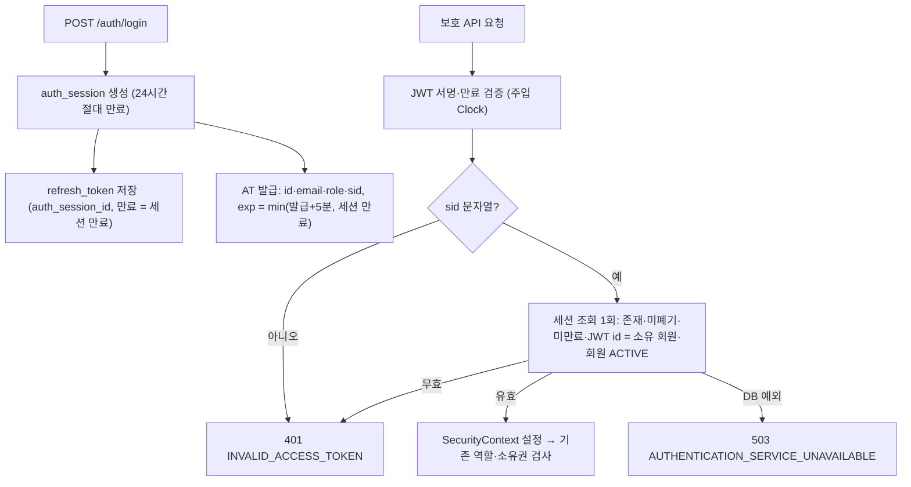

# SlotKey V2 인증 구현 해설 — 1번 이슈: DB 로그인 세션

> 검토 시점: 2026-10-18 (KST)
> 검토 대상: 브랜치 `auth/improvement/v2`의 **미커밋 작업 트리**. 기준 HEAD `16b9ead32e4608d1cc41ec70a62612b526a34c55`에는 이 구현이 들어 있지 않다. 커밋되면 이 문서의 기준을 그 커밋으로 바꾼다.
> 상태: 1번 이슈 구현·회귀 검증·코드 리뷰 완료, 미커밋·미배포(2026-10-18). 근거와 남은 배포 전 확인은 [V2 계획 §0](../plans/auth/v2-plan.md#0-진행-상태-2026-10-18-리뷰-기준).
> 범위: V2 1번 이슈(로그인별 DB 세션, 현재 세션 로그아웃)만 다룬다. 2번(정지·재설정·탈퇴의 세션 영구 폐기), 3번(RT Rotation·재사용 탐지), 4번(요청 제한)은 아직 구현되지 않았다.
> 관련 문서: [V2 계획](../plans/auth/v2-plan.md) · [인증 정책](../decisions/authentication-policy.md) · [인증 보안 테스트](../testing/auth-security-tests.md) · V1 기준점은 [V1 구현 해설](auth-v1-implementation.md)

## 1. 구조 한눈에 보기

## 2. 데이터 모델 (V24)

| 테이블 | 변경 | 비고 |
| --- | --- | --- |
| `auth_session` | 신규. `id`(UUID 문자열, PK), `member_id`(FK → `member`), `created_at`, `expires_at`, `revoked_at` | 인덱스 `idx_auth_session_member_id`. 만료는 생성 시 +24시간으로 고정하며 갱신하지 않는다 |
| `refresh_token` | `auth_session_id VARCHAR(36) NOT NULL` + FK → `auth_session`, 인덱스 추가 | 엔티티 `RefreshToken.authSession`(`@ManyToOne`, optional=false) |

V24는 먼저 `DELETE FROM refresh_token`으로 **전환 전 V1 RT 기록을 삭제**한 뒤 테이블·컬럼·FK를 만든다. 이 삭제는 V1 → V2 전환 시 한 번만 실행되는 합의된 정책이며, 이후 RT를 사용·교체할 때 기록을 지우는 정책이 아니다(사용한 RT 기록 보존 방식은 3번 이슈에서 정한다). 테이블·제약은 [ERD](erd.md)에 "V24, dev 병합 전" 표시로, API 계약 변화는 [API 명세 §2-5](../api/api-spec.md#2-5-v2-1번-변경--db-로그인-세션-dev-병합-전)에 반영했다.

## 3. 요청별 동작

| 경로 | 동작 | 코드 |
| --- | --- | --- |
| 로그인 | 한 트랜잭션에서 세션 생성 → 같은 세션의 RT 저장 → 같은 `sid`로 AT 발급 | `AuthService.login`, `RefreshTokenService.issueRefreshToken`, `AuthSessionService.create` |
| 보호 요청 | JWT 검증 후 `sid`가 문자열이 아니면 401. `AuthSessionRepository.isUsable`(select 1회, 쓰기·잠금 없음)로 세션 존재·미폐기·`expires_at > now`·`member.id = JWT id`·`member.status = ACTIVE` 확인 | `CustomAuthenticationFilter`, `AuthSessionService.validate` |
| refresh | RT 해시 조회(세션 fetch) → RT 만료·폐기, 세션 활성 확인 → 회원 비관적 잠금 후 상태 확인 → 같은 `sid`로 새 AT. 세션·RT 만료는 바꾸지 않는다. **RT는 교체하지 않는다**(3번 이슈) | `RefreshTokenService.validateRefreshToken`, `AuthService.refresh` |
| 로그아웃 | 쿠키 RT의 세션을 폐기하고 그 세션의 RT를 bulk update로 폐기. 한 트랜잭션. 같은 회원의 다른 세션은 유지 | `RefreshTokenService.revokeRefreshToken` |
| DB 장애 | 세션 조회 중 `DataAccessException`·`PersistenceException`이면 인증을 설정하지 않고 공통 `ApiResponse` 503. 로그에는 예외 클래스 이름만 남긴다 | `AuthSessionService.validate`, `ErrorCode.AUTHENTICATION_SERVICE_UNAVAILABLE` |

## 4. 시간 처리

세션 생성, RT 만료 비교, JWT 발급(`iat`·`exp`)과 JWT 파서의 만료 판정이 모두 주입된 `Clock`(`ClockConfig`, Asia/Seoul)을 사용한다. 세션 만료(`LocalDateTime`)는 `clock.getZone()`으로 `Instant`로 바꿔 AT `exp` 상한으로 쓴다. 만료 비교는 세션 `expires_at > now`, RT `now < expires_at`, JWT `exp` 경과 시 거부로 같은 방향이다.

## 5. 회원 상태 차단과 세션 폐기의 구분

정지·탈퇴 회원의 기존 AT가 거부되는 것은 **보호 요청마다 회원 상태를 조회하기 때문**이다. 세션 자체를 폐기하지 않으므로 정지 후 복구하면 정지 전 세션의 AT·RT가 다시 유효해진다. 비밀번호 재설정도 기존 세션을 폐기하지 않는다. 이 영구 폐기와 복구 후 폐기 유지는 2번 이슈이며 `V2SecurityRedTest`의 해당 시나리오는 아직 `@Disabled`다.

## 6. 전환·배포 영향 (코드로 확인한 범위)

- 기존 AT에는 `sid`가 없어 거부되고, 기존 RT는 V24가 삭제한다 → 모든 사용자가 다시 로그인해야 한다.
- 구버전 서버는 `auth_session_id` 없이 RT를 저장하므로 V24 적용 DB에서 로그인할 수 없고, `sid`를 검사하지 않는다 → 구·신 서버 혼합 운영과 앱만 이전 버전으로 되돌리는 롤백은 불가하다. Flyway down 마이그레이션은 없다.
- 개발·운영 DB에 실제로 적용한 기록은 확인되지 않았다. 1차 초안 V24를 적용한 DB가 있으면 체크섬 불일치가 나므로 배포 전에 `flyway_schema_history`를 확인해야 한다.
- 로그인·refresh 경로의 DB 장애는 현재 Spring 기본 500이며, 보호 요청의 503과 맞추는 것은 후속 개선이다.

## 7. 범위 밖으로 남긴 것

역할 변경 즉시 반영(역할은 여전히 JWT claim), 세션 관리 API·화면, IP 제한, CSRF 개편, 소유권 전수 보완, 감사 로그 확대는 이번 구현에 없다. 기존 역할·소유권 검사 코드는 바뀌지 않았다.
