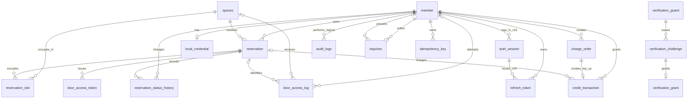

# ERD 및 데이터 모델

> 출처: 기획서 6-1, `데이터모델-아키텍처-결정.md`. 30분 슬롯 통일(항목 1), door_access_token 유니크 제약(항목 2), audit_logs 복합 인덱스(항목 4) 반영본.
> **2026-10-21 확인 (V3 Redis 실험, 운영 미적용)**: 이 ERD는 V2 기준이다. V3 실험 브랜치에만 있는 V27 `auth_session_revocation_retry`와 Redis 키 구조는 dev와 운영 스키마가 아니므로 넣지 않았다. V3는 운영 도입을 보류했다. 구조는 [V3 설계](../plans/auth/v3-redis-design.md), 판단은 [V3 인증 실험 결과](../testing/auth-v3-experiment-results.md).
> **2026-10-18 갱신 (V2 1번, dev 병합 전)**: 브랜치 `auth/improvement/v2`의 구현 커밋 `e671c47`(로컬 커밋 완료, 미Push·미병합·미배포)에 있는 `V24__create_auth_session_and_link_refresh_token.sql`과 엔티티를 대조해 `auth_session`과 `refresh_token.auth_session_id`를 **(V24, dev 병합 전)** 표시와 함께 반영했다. 병합 전까지 dev 스키마는 V23까지다. 동작 설명은 [V2 구현 해설](auth-v2-implementation.md).
> **2026-10-18 갱신 (V1 인증)**: V14~V16(PR #302)과 현재 엔티티를 대조해 `member.password_hash` 제거·`local_credential` 분리, `member.email_verified_at`, `verification_guard`·`verification_challenge`·`verification_grant`를 반영했다. V2 로그인 세션 등 계획 중인 모델은 구현 전이므로 넣지 않았다([V2 계획](../plans/auth/v2-plan.md)).
> **2026-10-16 갱신 (베스트 공간 랭킹)**: V22로 `space_ranking_snapshot` 테이블과 집계 인덱스 2개(`idx_reservation_status_start_space`, `idx_credit_transaction_type_created_reservation`)를 추가했다. `spaces.location`은 구조 변경 없이 판교·강남·하남만 쓰도록 요청 검증(`SpaceRegion`)으로 제한한다(DB 제약 아님).
> **2026-10-16 갱신 (5단계)**: V17~V20의 `waitlist_entry`, `processed_event`, `notification`을 반영했다. 세 테이블과 `outbox_event`는 모두 FK 없이 id만 참조하는 독립 테이블이다.
> **2026-09-24 갱신**: Flyway V1~V10 전수 대조를 바탕으로 V7 `idempotency_key`, V10 `inquiries`의 테이블·관계·인덱스를 ERD에 추가하고, V4 `payment`의 미생성(빈 마이그레이션 유지) 상태와 담당자 배정 사실(작성 시점 기록과 현재 구현 사실 분리)을 정비했다.

## 엔터티 및 담당자

| 엔터티 | 담당자 | 주요 필드 | 역할 |
| --- |-----| --- | --- |
| `member` | 천종원 | id, email, nickname, role, status, **balance**, email_verified_at, created_at, updated_at | 회원/관리자. `UNIQUE(email)`. role: USER / ADMIN. status: ACTIVE / SUSPENDED / WITHDRAWN. **balance**: 크레딧 잔액(int, NOT NULL, DEFAULT 0) — 이용 한도, 결제 수단 아님. 비밀번호 해시는 V14에서 `local_credential`로 옮기고 이 테이블에서 제거했다. `email_verified_at`(DATETIME(6), NULL 허용, V15): 신규 가입 시 가입에 쓴 SIGNUP challenge의 인증 시각을 기록한다. V15 적용 시점에 있던 회원은 적용 시각으로 일괄 채웠다(실제 메일 인증 시각이 아니라 정책상 인정 시각) |
| `local_credential` | 천종원 (V14) | member_id, password_hash, password_changed_at | 로컬 비밀번호 자격 증명. PK = FK `member_id`(`fk_local_credential_member`)로 회원당 최대 1행(엔티티 `@MapsId` 1:1). V14가 기존 `member.password_hash`를 재해싱 없이 옮기며 `password_changed_at`은 이전 시각으로 채웠다. 가입 시 생성, 비밀번호 재설정 시 해시와 변경 시각을 갱신한다. 로그인·재설정은 이 행이 없으면 실패한다 |
| `verification_guard` | 천종원 (V16) | id, email, purpose, failed_attempts, block_stage, blocked_until, admin_locked, last_sent_at | 이메일·목적별 인증 시도 상태. `UNIQUE(email, purpose)`(`uk_verification_guard_email_purpose`)이며 `INSERT ... ON DUPLICATE KEY UPDATE`로 만들고 `SELECT ... FOR UPDATE`(비관적 잠금)로 잠가 발급·확인·grant 사용을 직렬화한다. purpose: `SIGNUP` / `PASSWORD_RESET`(VARCHAR(30)). CHECK `failed_attempts BETWEEN 0 AND 5`, `block_stage BETWEEN 0 AND 3`. `blocked_until`은 1·2차 임시 차단 종료 시각, `admin_locked`는 3차 최종 잠금, `last_sent_at`은 30초 재발송 간격 기준. 회원 FK 없이 이메일 문자열로 연결한다(가입 전 이메일도 Guard를 가진다). 관리자 회원 복구 시 해당 이메일의 Guard를 모두 초기화한다 |
| `verification_challenge` | 천종원 (V16) | id, guard_id, code_hash, issued_at, expires_at, verified_at, invalidated_at | 발급한 인증번호 1건. FK `guard_id`(`fk_verification_challenge_guard`), 인덱스 `idx_verification_challenge_guard_id (guard_id, id)`. `code_hash`는 8자리 코드의 HMAC 검증값(64자). `expires_at` = 발급 + 3분. 확인은 Guard의 가장 최근 행만 대상으로 하며, 재발급·차단 시작 시 `invalidated_at`을 기록한다 |
| `verification_grant` | 천종원 (V16) | id, challenge_id, grant_hash, issued_at, expires_at, consumed_at, invalidated_at | 인증 성공 후 가입·재설정에 한 번 쓰는 증표. FK `challenge_id`(`fk_verification_grant_challenge`) + `UNIQUE(challenge_id)`(challenge당 최대 1개), `UNIQUE(grant_hash)`. 원문은 응답으로 한 번만 주고 해시만 저장한다. `expires_at` = 발급 + 5분. 이메일·목적 컬럼은 없고 challenge → guard로 귀속을 확인한다. `consumed_at`은 가입·재설정 트랜잭션에서 기록한다. `invalidated_at` 컬럼과 엔티티 메서드는 있으나 현재 이를 호출하는 운영 코드는 없다 |
| `refresh_token` | 천종원 | id, member_id, token_hash, expires_at, revoked_at, auth_session_id **(V24, dev 병합 전)** | 로그인 재발급 토큰. 원문 대신 해시 저장(`UNIQUE(token_hash)`), 재발급 시 검증 후 새 Access Token 발급. **V25(3번 커밋 `a29dfc9`, 로컬)**: `consumed_at DATETIME(6) NULL` 추가 — refresh 성공 시 구 RT에 기록하고 새 RT 행을 만든다(회전). 소비 기록은 재사용 탐지를 위해 보존하며 정리 작업은 없다. V24: `auth_session_id VARCHAR(36) NOT NULL` + FK `fk_refresh_token_auth_session` → `auth_session`, 인덱스 `idx_refresh_token_auth_session_id`. `expires_at`은 소속 세션의 만료와 같다. V24는 컬럼 추가 전에 기존(V1) 행을 모두 삭제한다(전환 1회) |
| `auth_session` **(V24, dev 병합 전)** | 천종원 | id, member_id, created_at, expires_at, revoked_at | 로그인 1회당 서버 세션. `id`는 UUID 문자열(VARCHAR(36), PK)이며 AT의 `sid` claim. FK `fk_auth_session_member` → `member`, 인덱스 `idx_auth_session_member_id`. `expires_at` = 생성 + 24시간으로 고정(갱신 없음). `revoked_at`은 로그아웃 시 기록. 탈퇴·관리자 정지·인증 최종 잠금 자동 정지·비밀번호 재설정 시 회원의 모든 세션과 RT에 `revoked_at`을 기록한다(V2 2번, 커밋 `02c3557`). 복구는 폐기 기록을 지우지 않는다 |
| `login_attempt_bucket` **(V26, 4번 커밋 `ee39f91`)** | 천종원 | email, window_id, attempt_count | 이메일별 로그인 요청 카운터. PK `(email, window_id)`, `window_id` = UTC 기준 15분 구간 번호, `attempt_count SMALLINT UNSIGNED` + CHECK `0~10`. `email`은 `VARCHAR(254)`이며 collation 미지정(DB 기본값, `member.email`과 같은 방식). FK 없음(미가입 이메일도 저장). 정리 작업 없음 — 현재 구간 이전 행은 판정에 쓰이지 않는다 |
| `spaces` | 김재철 | id, name, location, description, capacity, price_per_slot, image_path, opening_time, closing_time, status, **version** | 관리자가 등록하는 예약 대상 공간. `price_per_slot`은 100원 단위, 30분당 고정 요금. `opening_time`/`closing_time`은 30분 경계인 `TIME`(LocalTime) — "매일 반복되는 규칙"이므로 날짜 없음. **version**: 가격 등 변경에 대한 낙관적 비교용(int) |
| `audit_logs` | 김재철 | id, actor_member_id, action, target_type, target_id, reason, before_value, after_value, created_at | 관리 작업(공간 등록/수정, 회원 정지/복구, 강제취소, 크레딧 지급)과 시스템 PG 복구 수동 확인, 이메일 인증 3차 차단에 따른 시스템 회원 정지(`LOCK_MEMBER_BY_VERIFICATION`) 기록. 시스템 작업은 `actor_member_id=NULL`, 충전 복구는 `target_type=CHARGE_ORDER`, `action=CHARGE_RECOVERY_MANUAL_REVIEW`로 남긴다. 인덱스: `(target_type, target_id)`, V9 `idx_audit_logs_created_id (created_at, id)` |
| `reservation` | 이태호 | id, member_id, space_id, start_time, end_time, status, price_per_slot_snapshot, total_amount, **hold_expires_at**, **checked_in_at**, **checked_out_at**, cancelled_at, created_at | status: `HELD`/`EXPIRED`/`CONFIRMED`/`IN_USE`/`COMPLETED`/`CANCELLED`/`NO_SHOW` (7개). 슬롯 확보 시 `HELD` 생성(`hold_expires_at`=+10분) → Mock 결제 성공 시 `CONFIRMED` (2단계 플로우). ~~completed_at~~은 제거되어 `checked_out_at`으로 통합(체크아웃 시각 = 완료 시각) |
| `reservation_slot` | 이태호 | id, reservation_id, space_id, slot_start | 예약이 확보한 30분 단위 시간. **살아있는 점유일 때만 존재**(취소/노쇼/만료 시 하드 삭제). `UNIQUE(space_id, slot_start)`로 중복 점유 방지 |
| `credit_transaction` | 초기 분담: 미정 (구 `payment` 백한비 영역, V6 파일상 '담당: 미정' 기록; 실제 작성·현재 유지보수 담당 미확인) | id, member_id, amount, type, reservation_id, charge_order_id, balance_after, reason, created_at | **크레딧 원장(단일 진실)** — `payment` 테이블을 대체. `amount`는 부호 있음(지급/환급 +, 차감/위약금 -)이며 `SUM(amount) = member.balance`. `type`: SIGNUP_GRANT / ADMIN_GRANT / RESERVATION_CHARGE / REFUND / PENALTY / TOP_UP. PG 충전은 `charge_order_id` UNIQUE로 주문당 원장 1건을 강제한다. `INDEX(member_id, created_at)` |
| `charge_order` | lab 확장 | id, order_id, member_id, amount, status, payment_key, client_idempotency_key, pg_idempotency_key, failure_code, recovery_next_attempt_at, recovery_exhausted_at, created_at, updated_at | ACTIVE 회원의 PG 크레딧 충전 시도. `id`는 숫자 PK이며 `order_id`, `payment_key`, `pg_idempotency_key`는 각각 UNIQUE. `(member_id, client_idempotency_key)` UNIQUE로 같은 회원이 승인 멱등키를 다른 주문에 재사용하지 못하게 한다. 생성 시 `PENDING`, 승인 시 `CONFIRMING → PAID` 또는 명확한 거절이면 `FAILED`. `recovery_next_attempt_at`은 공정한 조회 재시도 시각, `recovery_exhausted_at`은 24시간 초과·무결성 위반으로 자동 복구를 중단한 시각이다. 복구 후보용 인덱스는 `(status, recovery_exhausted_at, recovery_next_attempt_at, id)`와 `(status, recovery_exhausted_at, updated_at, id)`이다. |
| `pg_webhook_event` | lab 확장 | id, transmission_id, event_type, order_id, payment_key, reported_status, retried_count, status, result, received_at, processed_at | 토스페이먼츠 웹훅(`PAYMENT_STATUS_CHANGED`) 수신 기록. 수신 즉시 `INSERT IGNORE`로 한 행을 넣고 200을 준다. `UNIQUE(transmission_id)`로 같은 알림의 중복 수신은 한 행만 남긴다. `order_id`·`payment_key`·`reported_status`는 서명 없는 본문에서 꺼낸 힌트이며 충전 확정의 근거가 아니다(확정은 PG 조회 후 `charge_order`의 기존 DB 2 경로). 원본 본문은 저장하지 않는다. `status`는 `RECEIVED`(수신) → `DONE`(처리기 처리 완료) 한 번만 바뀌며(조건부 UPDATE `WHERE status='RECEIVED'`), `result`는 처리 결과 이름(`CONFIRMED`, `ALREADY_PAID`, `ORDER_PENDING`, `ORDER_FAILED`, `ORDER_NOT_FOUND`, `ORDER_INVARIANT_VIOLATION`, `PG_NOT_APPROVED`, `PG_MISMATCH`, `PG_LOOKUP_ERROR`, `STATE_CONFLICT`, `COMPLETE_ERROR`), `processed_at`은 처리 시각이다(처리 전에는 둘 다 NULL). 인덱스 `(status, id)`. 한 주문에 여러 번 올 수 있고 생명주기가 달라 **FK 없음**. V23 |
| `outbox_event` | lab 확장 | id, event_id, event_type, topic, partition_key, payload(JSON), status, attempts, created_at, published_at | `SlotReleased` 이벤트 Outbox. 취소·강제 취소·홀드 만료(`updated==1`)의 성공 전이와 **같은 트랜잭션**에서 `PENDING`으로 INSERT한다(롤백되면 함께 사라짐). `event_type='SlotReleased'`, `topic='slot-released'`, `partition_key`는 `space_id` 문자열, payload는 `eventId`/`reservationId`/`reason`/`occurredAt`. **FK 없음**(Member/Space 잠금 순서 데드락 방지). `UNIQUE(event_id)`, `INDEX(status, id)`. V18 |
| `waitlist_entry` | lab 확장 | id, member_id, space_id, start_time, end_time, status, active, last_notified_at, created_at | 예약 대기 1건(점유 중인 구간에 "자리가 비면 알려 달라"). status: `WAITING`/`CANCELLED`/`EXPIRED`(`EXPIRED` 전이는 미구현). **FK 없음**(Member/Space 잠금 순서 데드락 방지). `active`는 `WAITING`일 때만 1, 그 밖에는 NULL이며 `UNIQUE(member_id, space_id, start_time, end_time, active)` — MySQL이 UNIQUE에서 NULL을 서로 다른 값으로 보는 성질로 "활성 신청은 구간당 1건 + 취소 이력 여러 건"을 만든다(`door_access_token.active_reservation_id`와 같은 방식). CHECK `chk_waitlist_entry_active`(`status`와 `active`가 어긋난 행 차단), `chk_waitlist_entry_time_range`. 인덱스 `(space_id, status, start_time)`, `(member_id, status)`. `last_notified_at`은 컨슈머가 알림을 저장할 때 조건부 UPDATE(`WHERE id AND status='WAITING'`)로만 기록하며, 엔터티는 `@DynamicUpdate`라 취소 flush가 이 값을 되돌리지 않는다. V17은 `reservation`에 `idx_reservation_member_space_status_start (member_id, space_id, status, start_time)`도 추가했다 |
| `processed_event` | lab 확장 | id, consumer, event_id, processed_at | 컨슈머가 처리한 이벤트 기록(멱등). 알림 저장과 **같은 트랜잭션**에서 `INSERT IGNORE`로 먼저 넣고 영향 행이 0이면 이미 처리한 이벤트로 보고 건너뛴다. `UNIQUE(consumer, event_id)` — 같은 토픽을 다른 컨슈머가 읽어도 서로 막지 않는다. `consumer`는 현재 `waitlist-notifier`. **FK 없음**. V19 |
| `notification` | lab 확장 | id, member_id, waitlist_entry_id, event_id, message, read_at, created_at | 대기자에게 보내는 "자리가 비었다" 알림. `message`는 생성 시점 문자열 스냅샷(선착순·예약 비보장 안내 포함). `read_at IS NULL`이면 안 읽음. `POST /notifications/read-all`은 토큰 회원의 NULL 행 중 `id <= upToId`인 행만 현재 시각으로 일괄 갱신하며 기존 읽음 시각을 유지한다. `UNIQUE(event_id, waitlist_entry_id)`로 같은 이벤트·같은 대기 항목의 중복 알림을 막는 두 번째 방어선(첫 번째는 `processed_event`). 인덱스 `(member_id, id)`(목록, 최신순), `(member_id, read_at)`(안 읽은 개수). **FK 없음**. V20 |
| `space_ranking_snapshot` | lab 확장 (V22) | id, period_type, period_start, space_id, location, net_revenue, reservation_count, slot_count, computed_at | 베스트 공간 랭킹의 **확정값**. 끝난 기간(`DAILY`/`WEEKLY`/`MONTHLY`)을 00:01(KST)에 한 번 계산해 저장하며 `UNIQUE(period_type, period_start, space_id)`로 덮어써 멱등을 보장한다. `location`은 계산 당시 값(이후 공간 지역이 바뀌어도 과거 지역 랭킹 불변). 순위(`rank`)는 저장하지 않고 조회 시 지표별 동점 규칙으로 정렬한다. 세 지표가 모두 0인 공간은 저장하지 않는다. **FK 없음**(독립 집계 테이블). UNIQUE 이름은 `uk_space_ranking_snapshot_period_space`, `net_revenue`는 음수가 될 수 있어 부호 있는 BIGINT다. 집계 보조 인덱스 `idx_reservation_status_start_space (status, start_time, space_id)`, `idx_credit_transaction_type_created_reservation (type, created_at, reservation_id)`도 같은 마이그레이션에서 추가했다. 결정: [decisions/space-ranking.md](../decisions/space-ranking.md) |
| `reservation_status_history` | 초기 분담: 백한비 / 실제 작성: 이태호 (V3 파일 비고에 '백한비님 대신 이태호가 작성' 명시) | id, reservation_id, changed_by_member_id, from_status, to_status, reason, changed_at | 상태 변경 이력. 최초 생성의 from_status는 NULL, 시스템 작업은 changed_by_member_id NULL 허용. 성공한 전이만 기록 |
| `door_access_token` | 박창현 | id, reservation_id, token_hash, issued_at, revoked_at, revoke_reason, active_reservation_id | `active_reservation_id`는 `revoked_at IS NULL`일 때만 값을 갖는 생성 컬럼 + `UNIQUE` → 예약당 활성 토큰 최대 1개를 DB 레벨로 강제 (변경 없음, §11 "유지") |
| `door_access_log` | 박창현 | id, actor_member_id, reservation_id, requested_space_id, result, reason_code, attempted_at | 출입 검증 결과. result: ALLOW / DENY. 식별 불가 대상은 NULL 허용. 세 컬럼 모두 DB 레벨 FK (`fk_door_access_log_actor_member`, `fk_door_access_log_requested_space`, `fk_door_access_log_reservation`) |
| `idempotency_key` | 이태호 (V7 작성 및 서비스 구현) | id, idempotency_key, member_id, request_path, response_status, response_body, created_at | 결제 멱등성 보장용(성공 응답 캐싱 및 동일 키 재요청 시 재생). `UNIQUE(idempotency_key, member_id, request_path)` |
| `inquiries` | 이태호 (초기 분담표 미기재, 2026-09-23 V10 작성 및 구현) | id, member_id, title, content, status, answer_content, answered_by_member_id, answered_at, created_at, updated_at | 회원 문의(Q&A) + 관리자 답변. 문의 1건당 답변 1건(1:1)으로 단순화 — 재질문/스레드형 재답변은 범위 밖. status: WAITING / ANSWERED. MVP 3대 기능 외 추가 구현 기능 |

> ~~`payment`~~ 테이블은 **애초에 생성하지 않고(V4 파일은 빈 마이그레이션으로 유지)** 결제 내역은 `credit_transaction` 원장으로 단일화한다.

## 관계

```
Member 1 --- N Reservation (DB FK: member_id)
Member 1 --- N RefreshToken (DB FK: member_id)
Member 1 --- N AuthSession (DB FK: member_id) — V24, dev 병합 전
AuthSession 1 --- N RefreshToken (DB FK: auth_session_id, NOT NULL) — V24, dev 병합 전. 현재 RT 회전이 없어 세션당 RT는 1개만 생긴다
Member 1 --- 0..1 LocalCredential (DB FK = PK: member_id)
VerificationGuard 1 --- N VerificationChallenge (DB FK: guard_id)
VerificationChallenge 1 --- 0..1 VerificationGrant (DB FK: challenge_id, UNIQUE)
Member.email 1 --- 0..2 VerificationGuard.email : 목적별 Guard (논리적 참조: FK 없음, 가입 전 이메일 포함)
Member 1 --- N CreditTransaction (DB FK: member_id)
Member 1 --- N ChargeOrder (DB FK: member_id)
ChargeOrder 1 --- 0..1 CreditTransaction (DB FK: charge_order_id, UNIQUE)
ChargeOrder.order_id 1 --- N PgWebhookEvent.order_id : 웹훅 수신 기록 (논리적 참조: FK 없음)
Member 1 --- N ReservationStatusHistory : 변경 수행자 (DB FK: changed_by_member_id, NULL 허용)
Member 0..1 --- N DoorAccessLog : 출입 요청자 (DB FK: actor_member_id, V5 fk_door_access_log_actor_member, NULL 허용)
Member 1 --- N AuditLog : 관리 작업 수행자 (논리적 참조: V2 actor_member_id에는 DB FK 제약 없음)
Member 1 --- N Inquiries : 문의 작성자 (DB FK: member_id)
Member 0..1 --- N Inquiries : 답변 관리자 (DB FK: answered_by_member_id, NULL 허용)
Member 1 --- N IdempotencyKey : 결제 멱등 키 소유자 (DB FK: member_id)

Space 1 --- N Reservation (DB FK: space_id)
Space 1 --- N ReservationSlot : 점유 대상 공간 (DB FK: space_id, V3 fk_reservation_slot_space)
Space 0..1 --- N DoorAccessLog : 출입 요청 공간 (DB FK: requested_space_id, V5 fk_door_access_log_requested_space, NULL 허용)

Reservation 1 --- N ReservationSlot (DB FK: reservation_id)
Reservation 1 --- N ReservationStatusHistory (DB FK: reservation_id)
Reservation 1 --- N DoorAccessToken (DB FK: reservation_id)
Reservation 0..1 --- N DoorAccessLog : 확인된 예약 (DB FK: reservation_id, V5 fk_door_access_log_reservation, NULL 허용)
Reservation 0..1 --- N CreditTransaction : 지급 건은 예약과 무관(NULL) (DB FK: reservation_id)

Member 1 --- N WaitlistEntry : 대기 신청자 (논리적 참조: FK 없음)
Space 1 --- N WaitlistEntry : 대기 대상 공간 (논리적 참조: FK 없음)
Member 1 --- N Notification : 알림 수신자 (논리적 참조: FK 없음)
WaitlistEntry 1 --- N Notification : 알림 대상 대기 항목 (논리적 참조: FK 없음, UNIQUE(event_id, waitlist_entry_id))
OutboxEvent.event_id 1 --- N ProcessedEvent.event_id : 컨슈머 처리 기록 (논리적 참조: FK 없음)
```



## 가격/슬롯 규칙 (결정 항목 1)

- 예약 최소 단위는 30분으로 통일. `spaces.price_per_slot`은 30분당 정액 요금(100원 단위).
- `reservation.price_per_slot_snapshot`은 예약 확정 시점의 요금 스냅샷. `total_amount = price_per_slot_snapshot × 점유 슬롯 수`.
- 공간 요금이 바뀌어도 이미 확정된 예약의 스냅샷/총액은 바뀌지 않는다.
- **가격 확인(낙관적 검증)은 `spaces.version`으로 한다** (가격 값 자체가 아니라 버전 비교 — ABA 문제 방지, §5-2).

## 출입 토큰 유일성 (결정 항목 2)

- `door_access_token`에 `active_reservation_id`(생성 컬럼)를 두고 `UNIQUE(active_reservation_id)` 적용.
- MySQL 유니크 인덱스는 NULL을 여러 개 허용하므로, 폐기된 토큰 이력은 자유롭게 쌓이고 "현재 유효한 토큰은 예약당 1개"만 DB가 강제.
- 재발급(재입장) 시나리오: 새 토큰 발급 전 기존 활성 토큰을 먼저 폐기(`revoked_at` 세팅)하는 트랜잭션으로 처리.

## 크레딧 원장 규칙 (core-domain-decisions.md §1)

- `payment` 테이블은 애초에 생성하지 않고(V4 빈 마이그레이션 유지), `credit_transaction` 원장으로 단일화. 1크레딧 = 1원(`int`), `spaces.price_per_slot`과 동일 단위.
- `amount`에 부호를 담아 `SUM(amount) = member.balance`가 성립해야 한다.
- 차등 환불(취소 시 50%)은 `REFUND +전액`과 `PENALTY -위약금`을 **두 줄로 분리 기록**한다(한 줄로 합치지 않음).
- 차감은 조건부 UPDATE(`WHERE balance >= :amount`)로 처리하며, 엔티티 dirty checking에 맡기지 않는다(갱신 유실 방지).

## 무결성 제약 (CHECK) — core-domain-decisions.md §11

```sql
-- reservation
CHECK (start_time < end_time)
CHECK (status <> 'HELD'      OR hold_expires_at IS NOT NULL)
CHECK (status <> 'CANCELLED' OR cancelled_at   IS NOT NULL)
CHECK (status <> 'COMPLETED' OR checked_out_at IS NOT NULL)
CHECK (status NOT IN ('IN_USE','COMPLETED') OR checked_in_at IS NOT NULL)

-- spaces
CHECK (opening_time < closing_time)          -- 자정 넘는 운영은 범위 밖

-- inquiries (V10)
CHECK (status <> 'ANSWERED' OR (answer_content IS NOT NULL AND answered_at IS NOT NULL))
```

## 확인됨 — 변경 없음 (core-domain-decisions.md §11 "확인" 항목)

- `spaces.opening_time` / `closing_time`은 `TIME`(LocalTime)이며 30분 경계로 검증한다.
- `reservation_slot`은 이미 "살아있는 점유일 때만 존재"하도록 설계되어 있으며(취소/노쇼/만료 시 하드 삭제), `UNIQUE(space_id, slot_start)`도 유지된다. 추가 변경 없음.
- `door_access_token.active_reservation_id` UNIQUE 제약은 그대로 유지된다.
- `idempotency_key`의 `UNIQUE(idempotency_key, member_id, request_path)` 제약은 그대로 유지된다.

## 2026-09-15 ~ 2026-09-24 변경 이력 (core-domain-decisions.md §11 및 V1~V10 반영)

| 구분 | 대상 | 상태 |
| --- | --- | --- |
| 미생성 | `payment` 테이블 전체 | 반영 완료 (ERD에서 제거). DDL상 `payment` 테이블이 애초에 생성된 적이 없고(V4 빈 마이그레이션 유지) `credit_transaction` 원장으로 단일화됨 |
| 추가 | `member.balance` (int, NOT NULL, DEFAULT 0) | ERD + `V1` DDL 반영 완료 (`member` 테이블 생성 시 컬럼 포함) |
| 추가 | `credit_transaction` 테이블 | ERD 반영 + `V6__create_credit_transaction_table.sql` 신규 작성 완료 |
| 추가 | `reservation.hold_expires_at` (datetime, NULL 허용) | ERD + `V3` DDL 반영 완료 |
| 추가 | `reservation.checked_in_at`, `checked_out_at` | ERD + `V3` DDL 반영 완료 |
| 추가 | `spaces.version` (int) | ERD 반영 완료 (당시 `V2` DDL상 `space.version`으로 추가되었으며 이후 V8에서 테이블명 rename) |
| 변경 | `reservation.status` enum → 7개 | ERD 반영 완료. 컬럼 타입(VARCHAR(20))은 기존과 동일, 허용 값만 애플리케이션에서 확장 |
| 변경 | `reservation.completed_at` 제거 → `checked_out_at`으로 통합 | ERD + `V3` DDL 반영 완료 |
| 확인 | `spaces.opening_time`/`closing_time` = TIME | 30분 경계 검증 적용 |
| 변경 | `space` → `spaces` | `V8__rename_space_to_spaces.sql`로 실제 테이블명 변경 |
| 확인 | `reservation_slot` 존재 조건, UNIQUE 제약 | 변경 없음 확인 |
| 유지 | `door_access_token.active_reservation_id` UNIQUE | 변경 없음 |
| 추가 | `idempotency_key` 테이블 | ERD 반영 + `V7__create_idempotency_key_table.sql`로 결제 멱등성 보장(성공 응답 캐싱) 추가 |
| 추가 | `idx_audit_logs_created_id (created_at, id)` | `V9__add_audit_logs_created_at_id_index.sql`로 감사 로그 정렬·날짜 필터 최적화 복합 인덱스 추가 |
| 추가 | `inquiries` 테이블 | ERD 반영 + `V10__create_inquiry_table.sql`로 회원 Q&A 및 관리자 답변 테이블 추가 |
| 추가 | `charge_order` 테이블 및 `credit_transaction.charge_order_id` | ERD 반영 + `V13__create_charge_order_table.sql`로 PG 충전 주문, UNIQUE `order_id`·`payment_key`·`pg_idempotency_key`, 회원별 UNIQUE `client_idempotency_key`, 상태·복구 추적 컬럼과 후보 조회 인덱스, 주문당 TOP_UP 원장 1건을 보장하는 UNIQUE FK 추가 |
| 분리 | `member.password_hash` → `local_credential` | `V14__separate_local_credential.sql`로 회원당 1행(PK=FK) 자격 증명 테이블을 만들고 기존 해시를 옮긴 뒤 `member.password_hash` 삭제 |
| 추가 | `member.email_verified_at` | `V15__add_member_email_verified_at.sql`. 기존 회원은 적용 시각으로 채움 |
| 추가 (dev 병합 전) | `auth_session`, `refresh_token.auth_session_id` | `V24__create_auth_session_and_link_refresh_token.sql`(브랜치 `auth/improvement/v2`, 커밋 `e671c47`, 미병합). 기존 `refresh_token` 행 삭제 → `auth_session` 생성 → `auth_session_id NOT NULL` + FK·인덱스 추가. 롤백용 down 마이그레이션 없음. 실제 개발·운영 DB 적용 이력은 미확인 |
| 추가 (3번 로컬 커밋 `a29dfc9`) | `refresh_token.consumed_at` | `V25__add_refresh_token_consumed_at.sql`(브랜치 `auth/improvement/v2`, 커밋 `a29dfc9`). NULL 허용 컬럼 추가만 하며 기존 행은 미소비로 남는다 |
| 추가 (4번 커밋 `ee39f91`) | `login_attempt_bucket` | `V26__create_login_attempt_bucket.sql`. 새 테이블만 만들고 기존 데이터는 바꾸지 않는다 |
| 추가 | `verification_guard`·`verification_challenge`·`verification_grant` | `V16__create_verification_tables.sql`. `UNIQUE(email, purpose)`, CHECK 2개, `(guard_id, id)` 인덱스, grant의 `UNIQUE(challenge_id)`·`UNIQUE(grant_hash)` |
| 추가 | `outbox_event` 테이블 | ERD 반영 + `V18__create_outbox_event_table.sql`로 슬롯 해제 이벤트 기록 테이블 추가. FK 없음, UNIQUE `event_id`, INDEX `(status, id)` |
| 추가 | `waitlist_entry` 테이블, `reservation` 인덱스 | ERD 반영 + `V17__create_waitlist_entry_table.sql`로 예약 대기 테이블(활성 UNIQUE, CHECK 2개, 인덱스 2개)과 `idx_reservation_member_space_status_start` 추가. FK 없음 |
| 추가 | `processed_event` 테이블 | ERD 반영 + `V19__create_processed_event_table.sql`로 컨슈머 멱등 기록 추가. `UNIQUE(consumer, event_id)`, FK 없음 |
| 추가 | `notification` 테이블 | ERD 반영 + `V20__create_notification_table.sql`로 대기자 알림 추가. `UNIQUE(event_id, waitlist_entry_id)`, 인덱스 `(member_id, id)`·`(member_id, read_at)`, FK 없음 |
| 추가 | `pg_webhook_event` 테이블 | ERD 반영 + `V23__create_pg_webhook_event_table.sql`로 웹훅 수신 기록 추가(처리 결과 `result` 컬럼 포함). `UNIQUE(transmission_id)`, 인덱스 `(status, id)`, FK 없음. V22는 `feat/space-ranking`이 사용하므로 그 브랜치가 `dev`에 먼저 머지되어야 한다 |

### 이번 반영에서 함께 발견/수정한 모순

- **[수정] 테이블명 정합화**: V2~V5에서 사용하던 `space` 테이블은 V8에서 `spaces`로 rename되며, 엔티티와 현재 FK는 `spaces`를 사용한다.
- **[구현 완료 및 정리] 마이그레이션 상태**: V1(`member`, `refresh_token`), V2(`space`, `audit_logs`), V3(`reservation`, `reservation_slot`, `reservation_status_history`), V5(`door_access_token`, `door_access_log`), V6(`credit_transaction`), V7(`idempotency_key`), V8(`rename`), V9(`index`), V10(`inquiries`)은 정상 구현 완료되었으며, V4(`payment`)는 결제가 크레딧 원장(V6 `credit_transaction`)으로 단일화되어 의도적으로 빈 마이그레이션으로 유지된다.
- `audit_logs`는 감사 로그 엔티티의 실제 테이블명이며, 이 문서도 동일한 이름을 사용한다.
