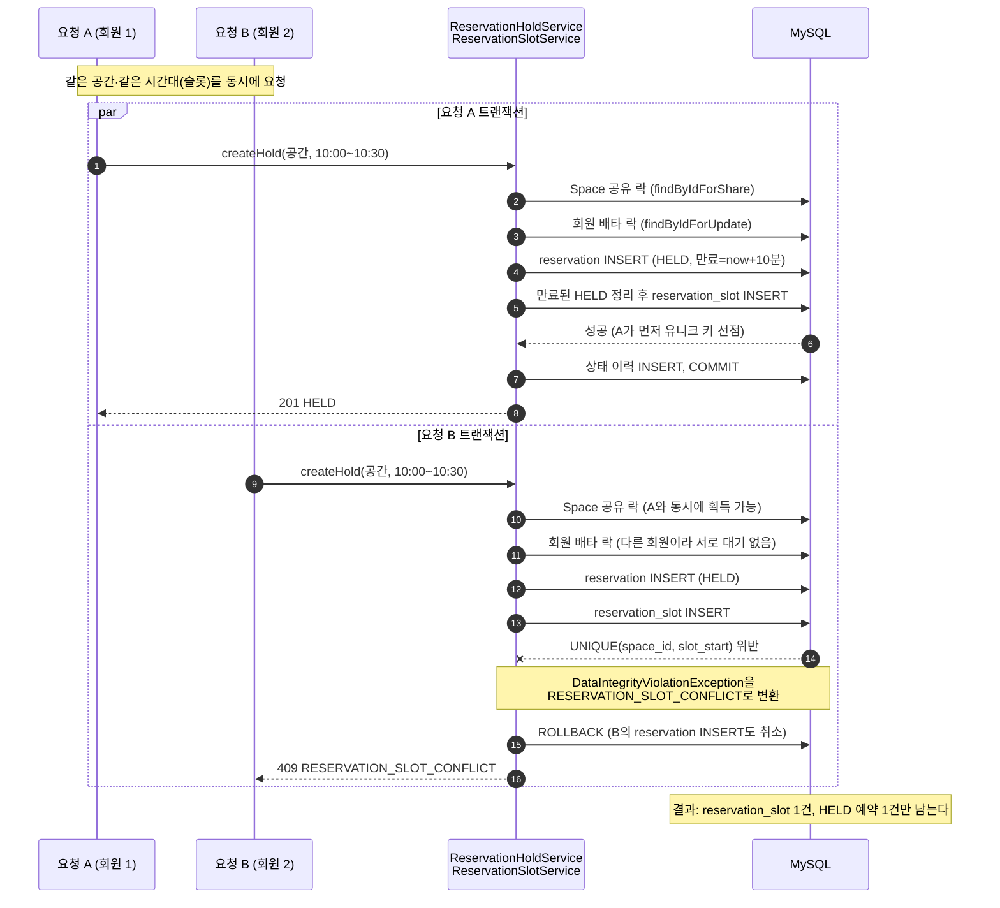

# 동시성 제어 시퀀스 — 같은 슬롯 HOLD 요청은 INSERT 성패로 판정한다

> **한 줄 메시지**: 슬롯이 비었는지 미리 조회하지 않는다. `reservation_slot`의 `UNIQUE(space_id, slot_start)`에 INSERT한 결과가 유일한 판정이고, 진 쪽은 예약 INSERT까지 통째로 롤백된다.

대상 API: `POST /reservations` (HOLD 생성, `ReservationHoldService.createHold`)

## 왜 이렇게 했는가

- **사전 가용성 조회는 참고값일 뿐이다.** 조회와 INSERT 사이에 다른 요청이 끼어들 수 있으므로, DB 유니크 제약을 최종 판정으로 삼았다. 애플리케이션 락 없이도 정합성이 보장된다.
- **실패하면 전체 롤백이다.** 슬롯 확보가 실패하면 같은 트랜잭션에서 INSERT한 HELD 예약도 사라져 잔재가 남지 않는다.
- **Space 공유 락은 슬롯 경합을 막는 장치가 아니다.** 관리자의 공간 수정(배타 락)과 예약 처리가 섞이지 않게 순서를 정하는 용도다. 공유 락끼리는 동시에 진행되므로 요청 A와 B는 서로 기다리지 않는다.
- **회원 배타 락은 같은 회원의 동시 HOLD 데드락을 막는다.** 예약 INSERT 시 FK 검사로 회원 행에 공유 락이 걸려 S→X 전환 데드락(MySQL 1213)이 날 수 있어서, INSERT 전에 배타 락을 먼저 잡는다. 이 다이어그램은 서로 다른 회원 요청이라 대기가 없다.

## 이 그림이 보여주지 않는 것

- 같은 슬롯에 대한 두 번째 INSERT가 첫 트랜잭션 커밋 전에 오면 InnoDB가 대기시킨 뒤 결과를 정한다. 첫 트랜잭션이 롤백되면 두 번째가 성공할 수 있다. 이 대기 동작은 MySQL 기본 동작이며, 레포 문서나 코드에서 별도로 확인한 내용은 아니다.
- 결제(`/pay`)와 연장의 동시성은 별도 그림으로 다룬다(조건부 UPDATE가 최종 방어선).

## 근거

| 내용 | 위치 |
| --- | --- |
| 처리 순서 | `backend/src/main/java/com/ovengers/slotkey/reservation/service/ReservationHoldService.java` `createHold` |
| 슬롯 INSERT와 409 변환, 만료 HELD 정리 | `backend/src/main/java/com/ovengers/slotkey/reservation/service/ReservationSlotService.java` `secureSlots` |
| 유니크 제약 | `backend/src/main/resources/db/migration/V3__create_reservation_tables.sql` `uq_reservation_slot_space_start` |
| 검증 테스트 | `ReservationConcurrencyTest`: 같은 슬롯 20개 동시 요청에 1건 성공, 19건 409 (`docs/decisions/reservation-concurrency.md` 기준, 테스트 파일은 직접 열어보지 않음) |
| 결정 기록 | [`docs/decisions/reservation-concurrency.md`](../decisions/reservation-concurrency.md) |
