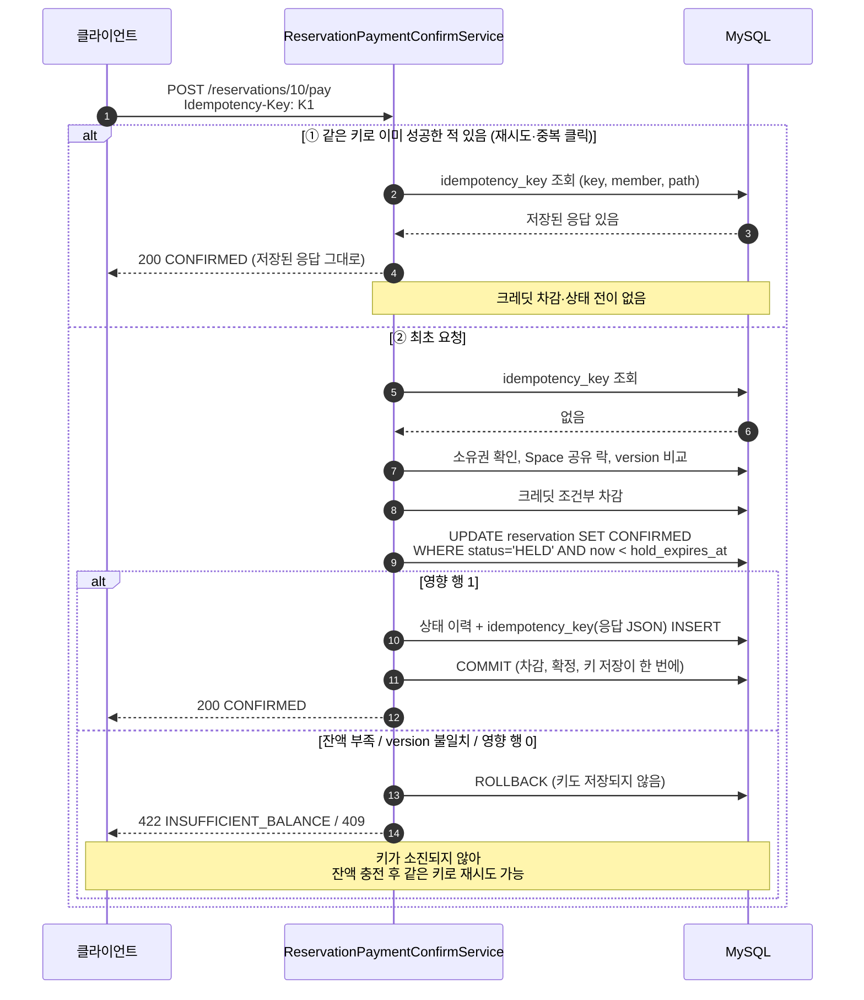
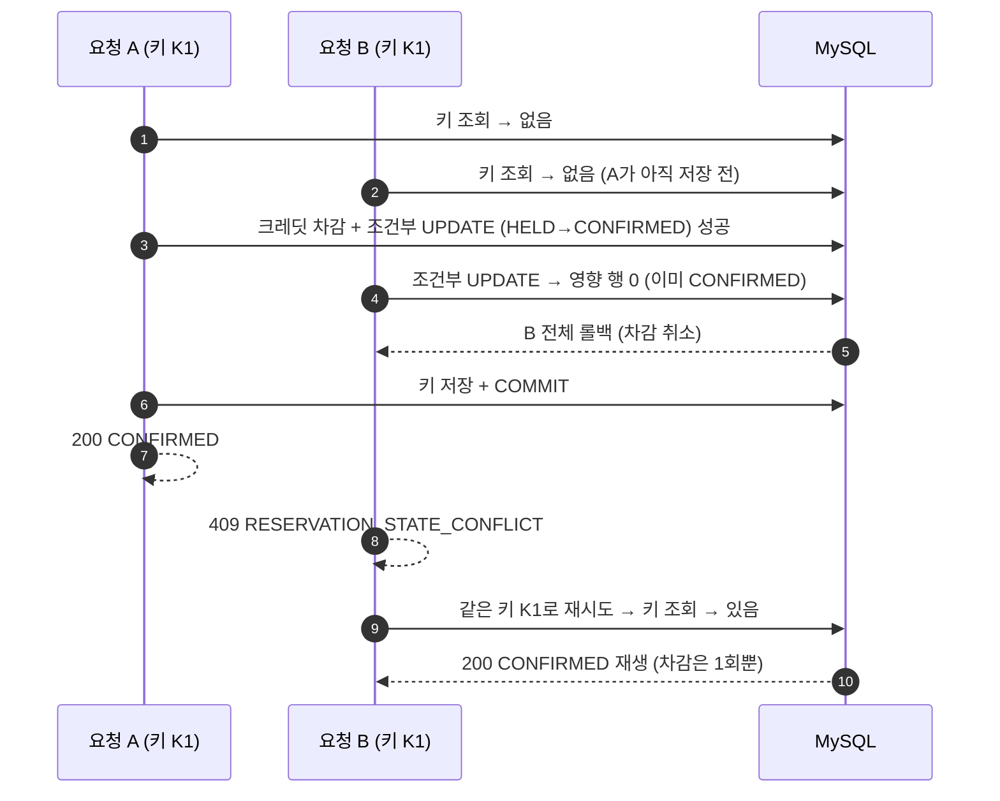

# 멱등성 흐름 — 같은 Idempotency-Key는 최초 성공 응답을 재생한다

> **한 줄 메시지**: 결제 확정(`POST /reservations/{id}/pay`)이 성공하면 응답을 같은 트랜잭션에 저장하고, 같은 키로 다시 오면 결제 로직을 건너뛰고 그 응답을 돌려준다. 실패한 요청은 키를 소진하지 않는다.

## 동시에 같은 키가 도착하는 좁은 경합 (의도적으로 남긴 틈)

## 왜 이렇게 했는가

- **돈이 움직이는 `/pay`에만 키를 요구한다.** HOLD 생성(`POST /reservations`)은 결제가 없어서 대상이 아니다.
- **성공 응답만 저장한다.** 실패는 롤백되어 키가 남지 않으므로, 잔액을 채운 뒤 HOLD 만료 전에 같은 키로 다시 결제할 수 있다.
- **키 저장을 결제 트랜잭션에 넣었다.** 차감과 확정은 됐는데 키 저장만 빠지는 중간 상태가 생기지 않는다.
- **이중 결제의 최종 방어선은 키가 아니라 조건부 UPDATE다.** 조회와 저장이 분리되어 동시 경합 창이 남지만, 한쪽만 확정되고 다른 쪽은 409로 롤백된다. 이 틈을 막으려고 락을 더 얹지 않은 것이 트레이드오프다.

## 한계

- 같은 키에 **다른 본문**을 보냈을 때의 충돌 검사는 없다(키 범위는 `idempotency_key + member_id + request_path`).
- `idempotency_key` 테이블에 보관 기간(TTL)이 없어 레코드가 계속 쌓인다.

## 근거

| 내용 | 위치 |
| --- | --- |
| 처리 순서, 롤백 조건 | `backend/src/main/java/com/ovengers/slotkey/reservation/service/ReservationPaymentConfirmService.java` `confirm` |
| 키 조회·저장, 경합 창 주석 | `backend/src/main/java/com/ovengers/slotkey/global/idempotency/IdempotencyService.java` |
| 유니크 제약 | `backend/src/main/resources/db/migration/V7__create_idempotency_key_table.sql` `uq_idempotency_key_scope` |
| 검증 테스트(문서 기술 기준, 테스트 파일은 직접 열어보지 않음) | `ReservationPaymentConcurrencyTest#pay_sameKeyRepeated_chargesOnce`, `#pay_sameKeyConcurrently_chargesOnceAndReplays` |
| 결정 기록 | [`docs/decisions/reservation-idempotency.md`](../decisions/reservation-idempotency.md), [`docs/decisions/reservation-concurrency.md`](../decisions/reservation-concurrency.md) |
