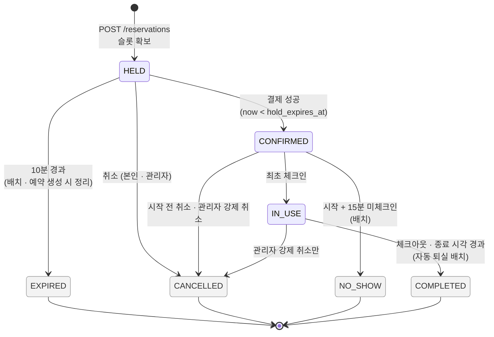

# 예약 상태 전이도 — 7개 상태와 허용된 전이만 존재한다

> **한 줄 메시지**: 예약은 `HELD`에서 시작해 4개의 종료 상태 중 하나로 끝난다. 모든 전이는 조건부 UPDATE로 한 번만 통과하고, 되돌리는 전이는 없다.

## 상태별 자원 처리

| 상태 | 슬롯 | 환불 | 출입 토큰 |
| --- | --- | --- | --- |
| `HELD` | 점유 | — | 발급 불가 |
| `CONFIRMED` | 점유 | — | 발급 가능 |
| `IN_USE` | 점유 | — | 재입장 허용 |
| `EXPIRED` | 삭제 | — | — |
| `CANCELLED` | 삭제 | 본인 취소는 100% 또는 50%, 관리자 강제 취소는 결제분 전액, `HELD`는 없음 | 폐기 |
| `NO_SHOW` | 삭제 | 없음 | 폐기 |
| `COMPLETED` | 유지 | 없음 | 폐기 |

## 허용되지 않는 전이

종료 상태(`EXPIRED`, `CANCELLED`, `NO_SHOW`, `COMPLETED`)에서는 어디로도 갈 수 없다. `HELD → IN_USE`(결제 없는 입장), `NO_SHOW → IN_USE`(15분 경과 후 입장)도 막혀 있다. 본인 취소는 `IN_USE`에서 할 수 없고 체크아웃으로 끝낸다.

## 왜 이렇게 했는가

- **`NO_SHOW`와 `CANCELLED`를 합치지 않았다.** 환불 정책이 다르고, 운영에서 "취소한 사람"과 "안 온 사람"은 다르게 봐야 하기 때문이다.
- **현재 상태는 컬럼에, 전이 기록은 이력 테이블에 둘 다 저장한다.** 상태로 목록을 필터링하고 정렬하려면 이력만으로는 인덱스를 걸 수 없다.
- **전이는 `WHERE status = :조회 시점의 상태` 조건부 UPDATE로 한다.** 동시에 다른 전이가 끝났다면 0행이 되어 환불이 두 번 나가지 않는다.

## 근거

| 내용 | 위치 |
| --- | --- |
| 7개 상태, 전이 다이어그램 | `backend/src/main/java/com/ovengers/slotkey/reservation/entity/ReservationStatus.java` |
| 전이 메서드와 선행 상태 검사 | `backend/src/main/java/com/ovengers/slotkey/reservation/entity/Reservation.java` |
| 본인 취소 (`HELD`, `CONFIRMED`) | `backend/src/main/java/com/ovengers/slotkey/reservation/service/ReservationCancelService.java` |
| 관리자 강제 취소 (`HELD`, `CONFIRMED`, `IN_USE`) | `backend/src/main/java/com/ovengers/slotkey/reservation/service/AdminReservationService.java` |
| 상태 정의, 허용되지 않는 전이, 전이 주체 | [`docs/core-domain-decisions.md`](../core-domain-decisions.md) §3-2 ~ §3-4, §6-4 |

> `Reservation.cancel`의 선행 상태 검사는 `CONFIRMED`만 허용하고, `HELD` 취소는 `ReservationCancelService`에서 별도 조건부 UPDATE로 처리한다. 두 경로를 코드에서 모두 확인했다. 환불 비율(100%/50%)의 시점 기준은 이 그림에 넣지 않았고, 정확한 기준은 `core-domain-decisions.md` §6-1과 `ReservationRefundPolicy`를 보면 된다.
